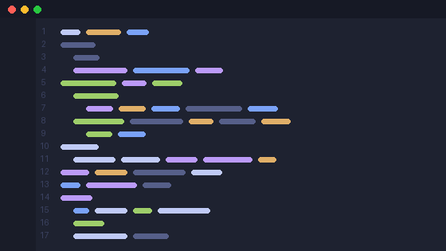
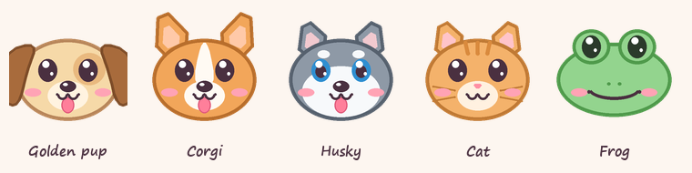

# Claude Buddy 🐶

A tiny friend that peeks out from the edge of your screen when a
[Claude Code](https://claude.com/claude-code) session needs you, and stays out
of the way while Claude works.





## What it does

- **Pops out from a screen edge** (random, or one you pick) on the monitor you're
  using. It waves and speaks up in its own voice:
  - **"woof! i need you"**: Claude wants permission or asked you a question
  - **"all done!"**: Claude finished, it's your turn
  - **"tests passed!"** with a party hat, when the turn ran tests that passed
  - **"done after 7 min!"** with confetti, after a long task
- **Allow / Always / Deny right in the bubble.** Permission requests can be
  answered without switching windows.
- **Click the buddy to jump to that session.** It brings the right Windows
  Terminal or VS Code window to the front.
- **Several sessions at once:** a `1/3 ‹ ›` pager in the bubble, questions first.
- **Doesn't ping you when you're already looking** at that session's window.
- **Falls asleep if ignored** (zzz), then nudges you once more after 5 minutes.
- **Hover for today's stats:** how long Claude waited on you, and how many pings.
- **Tray icon** for when it's hidden: hover for the waiting count, left-click to
  peek, right-click for the menu.
- **Quiet when it should be:** Do Not Disturb (1 hour / until 8am), optional
  quiet hours (10pm–8am), and silence during full-screen apps and presentations.
- **Says hi now and then** while you have sessions open (you can turn this off).
- **Five characters:** Golden pup, Corgi, Husky, Cat, Frog. Each has its own
  synthesized voice (bark, awoo, meow, ribbit), or a system beep, or silence.

Works with every local Claude Code session: terminals, the VS Code extension, and
several sessions at once.

## Install

Needs Python 3.8+ with tkinter (the python.org installer includes it).

```sh
git clone https://github.com/taniksha19/claude-buddy.git
cd claude-buddy
python install.py
```

The installer:

- installs [Pillow](https://pypi.org/project/pillow/) if it's missing (used to draw the buddy)
- adds hooks to `~/.claude/settings.json`, leaving your other hooks alone
- starts the buddy. After that, it starts with each new Claude session.

Start a new Claude session (or reload VS Code) so the hooks take effect. Then
right-click the buddy or its tray icon and pick **Test wave**.

To remove it: `python install.py --uninstall`. To stop it: `python buddy.pyw --quit`.

## Platforms

- **Windows 10/11:** everything above.
- **macOS / Linux:** experimental and untested. The hooks, approvals and drawing
  are cross-platform, but there's no tray icon. On Linux the buddy is drawn on a
  dark box instead of a transparent window, and jumping to a session needs
  `wmctrl`. Pull requests welcome!

## How it works

```
Claude Code ──hook events──▶ buddy_hook.py ──▶ sessions/<id>.json ◀── buddy.pyw (polls, draws)
                                  ▲                                        │
                                  └──────── sessions/<id>.answer.json ◀────┘  (Allow / Deny)
```

- `buddy_hook.py` runs on hook events (`UserPromptSubmit`, `PostToolUse`,
  `PermissionRequest`, `Notification`, `Stop`, ...). It records each session's
  state and which window it runs in.
- For a `PermissionRequest`, the hook only waits for the bubble when you're *not*
  looking at that session. It waits up to `approve_wait` seconds, and stops as
  soon as you switch to the window, so the normal prompt is never held up while
  you're right there.
- `buddy.pyw` is a click-through, per-pixel-alpha window drawn with Pillow
  (`render.py`). `sysutil.py` handles windows, focus, sound and Do Not Disturb.
- The art and the sounds are generated in code (`render.py`, `tools/make_sounds.py`).
  `tools/make_demo.py` renders the GIF above.

### Settings

Most settings are in the right-click menu. They're saved to `buddy_conf.json`:

| key | default | |
|---|---|---|
| `char` | `golden` | `golden`, `corgi`, `husky`, `cat`, `frog` |
| `side` | `random` | `random`, `bottom`, `top`, `left`, `right` |
| `sound` | `voice` | `voice`, `beep`, `off` |
| `approve` | `true` | offer Allow / Deny in the bubble |
| `approve_wait` | `60` | seconds the hook waits for a click before the normal prompt |
| `say_hi` | `true` | peek out to say hi every 25–45 min |
| `quiet_hours` | `false` | silent from 10pm to 8am |

### A note on approvals

Clicking **Allow** works exactly like approving in the terminal. **Always** also
saves the rule Claude Code suggests, the same as "don't ask again". Deny rules
in your settings still apply. The answer travels through a file in `sessions/`,
so anything running as your user could approve a request; turn `approve` off if
that worries you.
